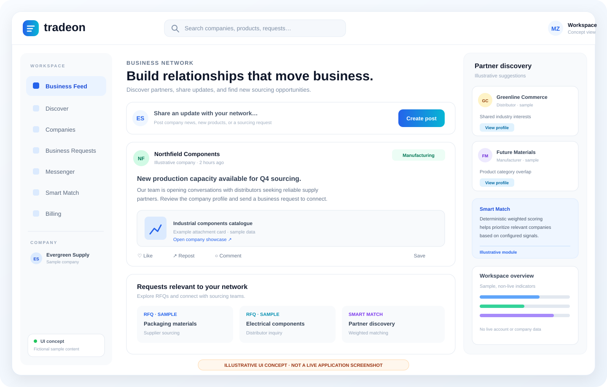
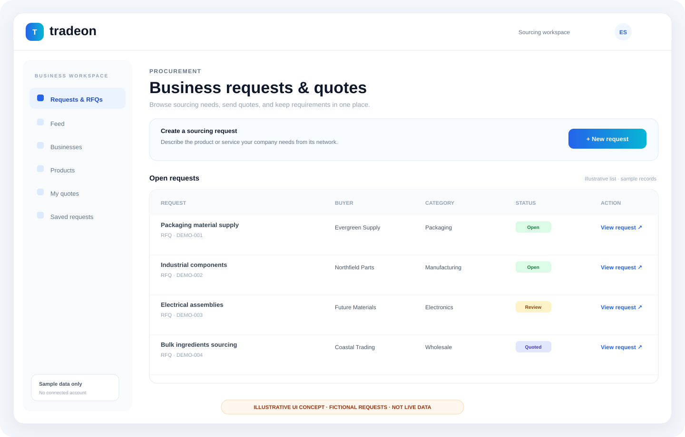
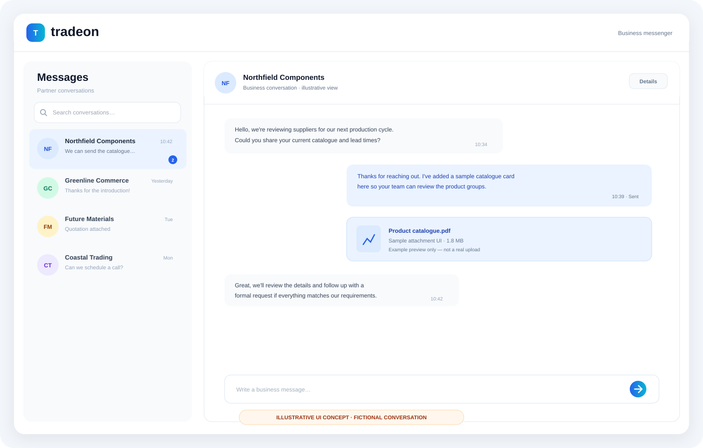

# Tradeon — Global Business Social Network

Tradeon is a production B2B business social network connecting manufacturers, suppliers,
distributors, buyers, brands and business professionals. Companies publish business posts,
sourcing requests and RFQs, discover partners through deterministic Smart Match, chat over
a business messenger (Laravel Reverb + polling fallback), and monetize through Paddle
subscription billing.

Stack: Laravel 13 · PHP 8.3+ · React 18 · Inertia.js 2 · Vite 8 · Tailwind CSS 3 ·
MySQL (prod) · Redis (prod) · Reverb · Paddle · Pest.

## Product presentation

### Product preview

**Static project overview:** [Open the GitHub Pages introduction](https://mohammedzomlot2007.github.io/Tradeon/) · **[Full source repository](https://github.com/MohammedZomlot2007/Tradeon)**

The GitHub Pages deployment is a static introduction only. It does not run Laravel, PHP, database queries, authentication, Reverb, queues, or Paddle webhooks. No full-stack production URL was verified as part of the 2026-10-18 review. The `/` route in the Laravel app renders the Inertia `Landing` page, and authenticated users are redirected to `/feed` (see `routes/web.php`).

### Visual product tour

> **Integrity note:** the SVGs below are illustrative UI concepts with fictional sample content. They are not screenshots captured from a running deployment and do not prove the corresponding screens are live.








Read the [architecture notes](docs/ARCHITECTURE.md), [verification record](docs/VERIFICATION.md), or [production runbook](deploy/production-runbook.md) for source paths and release steps.

### Architecture
```text
Browser
  └─ React 18 pages/components
       └─ Inertia.js 2 requests and page props
            └─ Laravel 13 / PHP 8.3+
                 ├─ Controllers, Form Requests, Policies, Middleware
                 ├─ MySQL (production persistence)
                 ├─ Redis (production cache/session/queue as configured)
                 ├─ Laravel Reverb + private conversation channels
                 │    └─ Polling fallback for chat updates
                 └─ Paddle billing
                      └─ Signed, idempotent server-side webhooks
```

Vite builds the React entry at `resources/js/app.jsx`. Pest tests live in `tests/Feature` and `tests/Unit`. Key domain areas include company onboarding, business feed, RFQs/quotes, company and product showcases, messaging, notifications, Smart Match, billing, and admin moderation. See the route table below and the relevant controllers/policies for implementation details.

### Core source areas
| Area | Source |
|---|---|
| HTTP routes and application entry | [routes/web.php](routes/web.php) |
| React/Inertia entry | [resources/js/app.jsx](resources/js/app.jsx) |
| Billing integration | [PaddleBillingService.php](app/Services/Billing/PaddleBillingService.php) |
| Test suite | [tests/Feature](tests/Feature) and [tests/Unit](tests/Unit) |
| Environment variable templates | [.env.example](.env.example), [.env.production.example](.env.production.example) |
| Production runbook | [deploy/production-runbook.md](deploy/production-runbook.md) |

### Verification and release status

| Check | Evidence available in this repository | Status |
|---|---|---|
| PHP syntax / route and security audit | [FINAL_AUDIT_REPORT.md](FINAL_AUDIT_REPORT.md) records 137/137 PHP syntax files passed, 53 unique named routes, and code-level middleware/policy checks. | **Documented code audit** |
| Pest tests | [CLIENT_HANDOVER.md](CLIENT_HANDOVER.md) records 114 tests / 340 assertions passing. The later [final audit](FINAL_AUDIT_REPORT.md) explicitly says the test suite was not re-run in that audit environment. | **Historical result; re-run required for current claim** |
| Frontend build | The handover reports a passing build, while the audit notes that a fresh build could not be executed because dependencies were absent. | **Historical result; current build not verified by this review** |
| GitHub Pages deploy | [Most recent Pages deployment run](https://github.com/MohammedZomlot2007/Tradeon/actions/runs/38033821629) completed successfully on 2026-10-10. This validates the static landing page deployment, not the Laravel application. | **Static page deployment passed** |
| Full production app / checkout / database / Reverb | No full-stack production host or live service evidence was verified during this review. | **Not verified** |

Do not describe Tradeon as production-live until the Laravel application is deployed to a PHP-capable host and smoke-tested with the intended database, queue/cache, mail, Reverb and Paddle environment. Do not publish payment secrets or private verification documents in screenshots.

### Run locally (Windows PowerShell)
```powershell
composer install
Copy-Item .env.example .env
php artisan key:generate
php artisan migrate
php artisan db:seed
php artisan storage:link
npm install --legacy-peer-deps
npm run build
composer run dev
```

Open `http://127.0.0.1:8000`. Configure the values documented in `.env.example` before exercising mail, real-time chat, storage services, or Paddle checkout. Use Paddle Sandbox credentials for billing tests unless you are deliberately preparing a production release. Demo content is opt-in; the standard seeder intentionally does not populate demo records.

### Before release
1. Run `php artisan test` and retain the complete command output.
2. Run `npm run build` and retain the build output.
3. Run `php artisan tradeon:smoke` against the deployed environment.
4. Smoke-test registration, company onboarding, feed and media, search/Smart Match, RFQs, private messaging, subscription checkout, signed webhooks, admin authorization, and Arabic/English.
5. Capture real browser screenshots at desktop and mobile widths using safe sample data and add the images under `docs/screenshots/`.

---

## Reproducible build, tests and browser screenshots

The [application-verification workflow](https://github.com/MohammedZomlot2007/Tradeon/actions/workflows/application-verification.yml) runs Composer/npm installation, `npm run build`, `php artisan test`, `php artisan tradeon:smoke`, and Playwright browser captures against a disposable local SQLite database. It creates a synthetic test account, company, and sample post only inside the CI runner. Logs and genuine rendered screenshots are uploaded as a 30-day GitHub Actions artifact.

- [Workflow runs](https://github.com/MohammedZomlot2007/Tradeon/actions/workflows/application-verification.yml)
- [CI and screenshot guide](docs/CI-VERIFICATION.md)

The workflow copies `.env.example` to an ephemeral untracked `.env`. It does not need production credentials or Paddle secrets. A real local `.env` is not present in this public repository and should never be committed.

## Local setup

```bash
composer install
cp .env.example .env
php artisan key:generate
php artisan migrate
php artisan db:seed        # billing plans + env-based admin bootstrap (no demo data)
npm install --legacy-peer-deps
npm run build              # or: npm run dev (see composer run dev)
php artisan serve
```

> `npm install` needs `--legacy-peer-deps` because `@vitejs/plugin-react@4` declares a
> Vite ≤7 peer while the project uses Vite 8. A passing build has been recorded historically;
> re-run the current build and inspect its output before release.

Create an administrator (never hardcoded):

```bash
php artisan tradeon:admin --name="Full Name" --username="handle" --email="admin@example.com"
# or non-interactively:
php artisan tradeon:admin --name="..." --username="..." --email="..." --password="..." --force
```

Alternatively set `TRADEON_ADMIN_NAME/USERNAME/EMAIL/PASSWORD` in `.env` before `db:seed`.

Demo content is opt-in and never seeded by default:

```bash
php artisan db:seed --class=BizLinkSeeder   # local development only
```

## Environment

All variables are documented in `.env.example` (local) and `.env.production.example`
(production). Production requires: `APP_KEY`, MySQL, Redis, SMTP, Reverb credentials,
Paddle client token + API key + price IDs + webhook secret, and `REVERB_ALLOWED_ORIGINS`.

## Key flows

| Area | Entry points |
|---|---|
| Feed (all / following / companies / RFQ) | `GET /feed`, `POST /posts`, like/comment/repost/save/report |
| Company onboarding | `GET/POST /onboarding/company` (one company per user, slug collision-safe) |
| Verification | `GET/POST /verification` (private-disk uploads), `GET /verification/{id}/document` (owner/admin only) |
| Factory & product showcases | `POST/PUT/DELETE /factory`, `/showcases` (company-owner only, managed on the company page) |
| Business requests & RFQ quotes | `GET/POST /requests`, `POST /rfq/{id}/quote` (active-only, one quote per company, no self-quotes) |
| Messenger | `GET /messages`, chat requests + accept/decline, realtime via Reverb private channels, 4s polling fallback |
| Notifications | `GET /notifications` (page) + JSON polling endpoint, read / read-all |
| Global search | `GET /search` (companies, manufacturers, products, requests) |
| Smart Match | `GET /smart-match`, `POST /api/smart-match` (deterministic weighted scoring, no randomness) |
| Billing | `GET /pricing`, `POST /billing/checkout/{plan}`, `GET /billing`, `POST /billing/webhooks/paddle` (signature-verified, idempotent) |
| Admin | `GET /admin` (users with search/filters, verification queue with notes + documents, report moderation, audit log) |

Paid access is granted exclusively by verified server-side webhook state — never by
browser checkout callbacks.

## Storage strategy

| Content | Disk | Visibility |
|---|---|---|
| Verification documents | `local` (`storage/app/private`) | private; served only through the authorized download route |
| Company logos/covers, public media | `public` (`storage/app/public`) | public via `storage` symlink |
| Production files | S3-compatible object storage | configure `FILESYSTEM_DISK` per environment |

## Realtime

```bash
php artisan reverb:start   # development
```

Configure `REVERB_*` plus `VITE_REVERB_*` for the browser client. In production run
Reverb behind TLS/reverse proxy and set `REVERB_ALLOWED_ORIGINS` to the real domain(s).
Private channels (`conversations.{id}`) authorize participants server-side
(`routes/channels.php`).

## Queue & scheduler

```bash
php artisan queue:work --tries=3
php artisan schedule:work   # or cron: php artisan schedule:run every minute
```

## Testing

```bash
php artisan test            # full Pest suite (auth, feed, RFQ, messenger, admin, billing, i18n flows)
```

Feature tests call `withoutVite()` so they never depend on frontend build artifacts.

## Deployment checklist

```bash
composer install --no-dev --optimize-autoloader
npm ci && npm run build
php artisan migrate --force
php artisan db:seed --force        # plans only (+ admin only if TRADEON_* env set)
php artisan config:cache && php artisan route:cache && php artisan view:cache
php artisan queue:work --tries=3   # under a process supervisor
```

Set `APP_ENV=production`, `APP_DEBUG=false`, `APP_FORCE_HTTPS=true`,
`SESSION_SECURE_COOKIE=true` with a real `APP_KEY`. Use encrypted daily database
backups and a monitored log sink. Never commit `.env`, `database/*.sqlite`,
`storage/logs/*`, `vendor/` or `node_modules/`.

## Troubleshooting

| Symptom | Fix |
|---|---|
| `Reverb ServerProviderManager::getDefaultDriver` type error | `config/reverb.php` must match the installed `laravel/reverb` version (regenerate from `vendor/laravel/reverb/config/reverb.php`) |
| `Please provide a valid cache path` | ensure `config/view.php` exists and `storage/framework/{views,cache,sessions}` exist; run `php artisan optimize:clear` |
| `Class "Redis" not found` locally | local `.env` must use `database`/`array` stores, not `redis` (no extension installed) |
| `Unknown adapter`/Vite manifest errors in tests | tests use `withoutVite()`; for real pages run `npm run build` |
| Paddle checkout shows "Setup Required" | fill `PADDLE_CLIENT_TOKEN` + plan price IDs; webhook destination `POST /billing/webhooks/paddle` |
