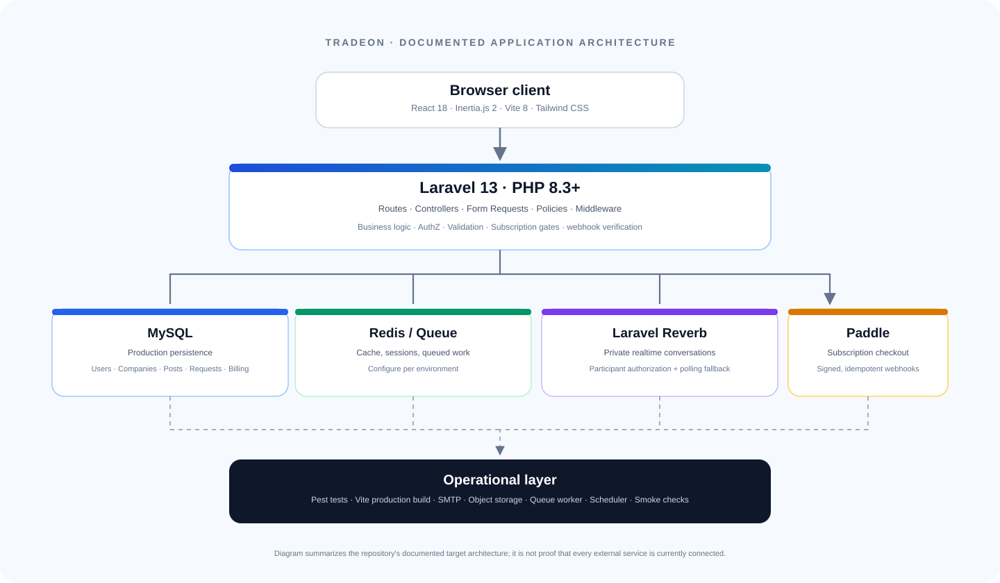

# Tradeon Architecture

This document summarizes the architecture documented by the source tree and README. It describes the intended application structure; it does not assert that production services are currently provisioned.

## Request path

1. The browser loads the React application through Vite's entry point at `resources/js/app.jsx`.
2. Inertia transports page visits and page props between React and Laravel.
3. Laravel routes requests to controllers, validates inputs through Form Requests, applies middleware and policies, and reads or writes domain models.
4. MySQL is the production database. Redis is listed for production cache/session/queue usage where configured.
5. Laravel Reverb provides private realtime conversation channels; the README documents a four-second polling fallback.
6. Paddle is the subscription provider. Billing access is based on server-side webhook state; webhook signature verification and idempotency are documented in the billing flow.

## Code map

| Concern | Entry point |
|---|---|
| Page and API routes | `routes/web.php`, `routes/channels.php` |
| React/Inertia boot | `resources/js/app.jsx` |
| Domain actions | `app/Http/Controllers/` |
| Authorization | `app/Policies/`, middleware in `app/Http/Middleware/` |
| Billing | `app/Services/Billing/PaddleBillingService.php`, `app/Http/Controllers/BillingController.php` |
| Background operations | `app/Console/Commands/`, Laravel queue and scheduler |
| Tests | `tests/Feature/`, `tests/Unit/` |
| Environment templates | `.env.example`, `.env.production.example` |
| Production setup | `deploy/production-runbook.md` |

## Main domains

- Business feed: posts, comments, likes, reposts, saved items and reports.
- Company onboarding and profiles: company slug, verification workflow and protected verification documents.
- Marketplace: factories, product showcases, sourcing requests and RFQ quotes.
- Business communications: connection graph, chat requests, private messenger, notifications.
- Discovery: global search and deterministic weighted Smart Match.
- Monetization and administration: subscription plans, Paddle webhooks, storage quotas, admin moderation and audit log.

## Environment responsibilities

- **PHP/Laravel host:** application requests, scheduled jobs, queues, and Reverb process.
- **MySQL:** durable production data.
- **Redis:** configure for production queues/cache/session as selected by the environment.
- **SMTP:** transactional mail and verification flows.
- **Object storage:** use the configured storage disk for production file uploads.
- **Paddle:** set production credentials and price IDs only when ready; never place secrets in the repository.
- **Web/reverse proxy:** TLS, allowed origins for Reverb, and persistent queue/scheduler supervisors.

The static GitHub Pages landing page is separate from this runtime. It cannot execute PHP or run the application database, authentication, queue, Reverb or Paddle webhook endpoints.
